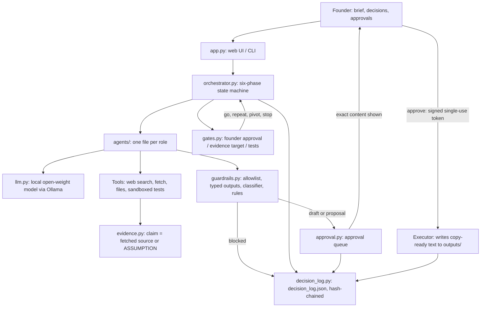

# Foundry Architecture

## Overview

Foundry is a team of AI agents run by a state machine. It takes a founder brief (starting idea, skills, budget, available time, target market, values) through six phases toward a validated, sellable digital product. Agents never act on the outside world: they produce drafts and proposals. Every step ends with a gate, every claim is sourced or labelled `ASSUMPTION`, every agent action is logged, and anything that would be published, sent, spent or signed waits for the founder to approve the exact content. Status labels in this file: **Working**, **STUBBED** (designed, not built), **MOCKED** (simulated and labelled).



## Phases

Each phase lists its agents, tools, method and output. Output files go to `outputs/` as `phase<N>_step<M>_<name>` and `phase<N>_gate_<name>`. All phase agents are **STUBBED** today; the state machine, gates, evidence store, approval queue and log they run on are **Working**.

### Phase 1: Discover

- **Core step:** find opportunities.
- **Agents:** `agents/researcher.py`, `agents/critic.py`.
- **Tools:** web search, page fetch, evidence store.
- **Method:** read the founder brief; reject excluded product types (physical goods; financial, investment or crypto; health or legal advice). The researcher sharpens the idea and proposes two or three alternatives that fit the founder's skills, budget and time. Each option is scored on the same criteria (problem severity, reachable market, fit with the founder, cheapness of a first test), with every market claim tied to a fetched source or labelled `ASSUMPTION`. The critic then gives the strongest case, the top risks, kill criteria and the cheapest test that could disprove the idea; its output schema rejects an empty risk list. The researcher drafts a Mom Test interview script (questions about past behaviour, no pitching). Interviews are done by the founder; simulated interviews are labelled `MOCKED` and never count as evidence.
- **Output:** `phase1_step1_opportunities.md`, `phase1_step2_interview_script.md`, `phase1_gate_decision.md`.

### Phase 2: Validate

- **Core step:** design the business.
- **Agents:** `agents/strategist.py`.
- **Tools:** evidence store, file tools.
- **Method:** fill a Lean Canvas where each box is a sourced claim or an `ASSUMPTION`. Before any test runs, the founder and system fix a demand target (for example 100 waitlist sign-ups in 14 days) and it is written to the log; it cannot be changed once the phase starts. The strategist drafts a landing page with no fake testimonials, counters or countdown timers; placeholder slots read `[Real customer quote - collect after launch]`. Publishing the page is a proposed action the founder approves. The founder records real sign-ups or interview results.
- **Output:** `phase2_step1_lean_canvas.md`, `phase2_step2_landing_page.html`, `phase2_gate_decision.md`.

### Phase 3: Build

- **Core step:** build the product.
- **Agents:** `agents/builder.py`.
- **Tools:** file tools; a sandboxed test runner (separate container, no network, CPU and memory limits, read-only root).
- **Method:** propose a product format and stack for approval, scaffold a minimum version, write tests and user docs, run the tests in the sandbox. Placeholder content is labelled `MOCKED`. Deploying is a proposed action.
- **Output:** `phase3_step1_mvp_plan.md`, `phase3_step2_test_report.md`, `phase3_gate_decision.md`.

### Phase 4: Commercial setup

- **Core step:** set the price and policies.
- **Agents:** `agents/pricing.py`.
- **Tools:** evidence store, file tools.
- **Method:** offer two or three pricing options with reasoning. Competitor prices are sourced; willingness to pay is an `ASSUMPTION` until tested. Draft terms, privacy and refund policies as drafts for the founder to review, marked as not legal advice. Publishing policies or accepting a platform's terms is a `sign` action that needs approval. No payments of any kind.
- **Output:** `phase4_step1_pricing.md`, `phase4_step2_policies.md`, `phase4_gate_decision.md`.

### Phase 5: Launch

- **Core steps:** open the store; deliver automatically.
- **Agents:** `agents/launcher.py`; `delivery.py`.
- **Tools:** approval queue, file tools.
- **Method:** draft the store page and launch posts. Each draft enters the approval queue; the founder approves or rejects the exact text. Approved items are written to `outputs/` as copy-ready text for the founder to post; no posting connector exists. Copy may not promise income or invent urgency. Automatic delivery to buyers is **MOCKED**: a simulated order triggers a simulated delivery record, labelled as such (see Sale to cash).
- **Output:** `phase5_step1_store_page.md`, `phase5_step2_launch_posts.md`, `payment_test_log.md` (mocked delivery run), `phase5_gate_decision.md`.

### Phase 6: Operate and learn

- **Core step:** none.
- **Agents:** `agents/operator.py`.
- **Method:** draft support replies for the founder to send, summarise metrics the founder provides, and write a persevere-or-pivot memo with the evidence for each option.
- **Output:** `phase6_step1_pivot_memo.md`.

## Gates

Every step ends with a gate. After each step the system shows a summary, its recommendation and the choices, then waits for the founder.

| Gate type | What it checks |
|---|---|
| Founder approval | The founder has reviewed the step's output and chosen an outcome |
| Evidence target | Sourced claims plus founder-recorded demand signals reach the target fixed before the phase started |
| Tests pass | The sandboxed test run passed |

| Phase | Gate |
|---|---|
| Discover | Founder approves the sharpened idea |
| Validate | Evidence target reached, plus founder approval |
| Build | Tests pass, plus founder review |
| Commercial setup | Founder approves pricing and policy drafts |
| Launch | No draft left unreviewed, at least one approved, plus founder approval |
| Operate and learn | Founder chooses the outcome from the memo |

**Outcomes:** go (advance), repeat, pivot back to an earlier phase, or stop. All four are logged with `approved_by: "founder"`.

**When the system recommends STOP.** `gates.py` returns a recommendation with every check. If the Validate evidence is below half of the pre-set target (example: target 100 sign-ups, got 12), the recommendation is **stop**, stated plainly with the numbers. Between half and the full target it is **repeat**. The system does not advance a project whose evidence gate has failed; the founder can repeat, pivot back or stop. Excluded product types get a stop recommendation in Discover. Downstream work is kept and marked stale on a pivot, never deleted.

## Sale to cash

**Not built. No payment code exists in this repository, not even sandbox.** This section is the design for a later version; in the prototype only delivery is simulated, and it is labelled **MOCKED**.

```
order placed ──> payment confirmed (by the founder's own provider) ──> delivery
                          │                                              │
                          └─ refund ──> access revoked                   └─ idempotency key = order id
                          
reconciliation: orders == payments - fees == payouts, mismatches listed for the founder
```

- **Payment triggers delivery.** The founder's own payment provider (outside Foundry) confirms a payment; that event carries an order id. Delivery grants access to the digital product for that order id.
- **Refund revokes access.** A refund event for an order id revokes that order's access.
- **Idempotency prevents double delivery.** Delivery is keyed by order id; a repeated event for the same order does nothing.
- **Reconciliation.** A periodic job matches orders, payments, fees and payouts and lists mismatches for the founder. Foundry reads these records; it never holds, moves or refunds money.
- **Prototype:** `delivery.py` will accept a simulated order, write a `MOCKED` delivery record, and prove the idempotency and revoke rules in tests. The run log goes to `outputs/payment_test_log.md` and states that no payment took place.

## Data flow

1. The founder submits a brief. The orchestrator creates a project and logs it.
2. An agent runs a step: it calls the local model and tools. Fetched pages become evidence records (URL, quote, date). A claim without a fetched source is stored as `ASSUMPTION`.
3. The agent returns a typed result. Guardrails check it: tool allowlist, typed outputs, model classifier (fails closed), keyword rules. A block is logged and shown to the founder.
4. The step output is written to `outputs/` and the action is appended to `decision_log.json` with `agent`, `action`, `sources`, `model`, `cost`, `approved_by` and a hash chain (`prev_hash`, `entry_hash`).
5. The gate is evaluated and a recommendation is shown. The founder decides; the decision is logged.
6. Outbound items (post, email, listing, deploy, support reply, sign) enter the approval queue. Approval creates a signed, single-use token bound to the content hash; any edit cancels it. The executor verifies the token and writes copy-ready text to `outputs/`. `spend` has no executor.
7. `scripts/verify_decision_log.py` checks the required keys and the hash chain.

Storage: SQLite (`data/`) for projects, evidence and the approval queue; `decision_log.json` and `outputs/` as plain text.

## Built vs. stubbed

| Part | Status |
|---|---|
| State machine, gates, STOP recommendation (`orchestrator.py`, `gates.py`) | Working |
| Evidence store (`evidence.py`) | Working; does not yet verify that a URL was fetched |
| Decision log (`decision_log.py`) | Working |
| Approval queue and tokens (`approval.py`) | Working through the Python API |
| Guardrails: keyword rules, tool allowlist (`guardrails.py`) | Working; misses rewordings and non-English prompts |
| Guardrails: model classifier | STUBBED (built, not on by default) |
| Model adapter (`llm.py`) | Working |
| Status page (`app.py`) | Working |
| Phase agents, prompts (`agents/`, `prompts/`) | STUBBED |
| Web search and fetch tools, sandboxed test runner | STUBBED |
| Approval screen in the browser, CLI | STUBBED |
| Delivery (`delivery.py`) | STUBBED; will be MOCKED |
| Posting connectors | STUBBED by design (copy-ready text only) |
| Payments, sale to cash | Not built; no payment code |

## Roadmap

1. Brief intake and Discover agents with fetched sources; step gates in the UI.
2. Approval screen; Launch drafts through the approval queue; mocked delivery.
3. Validate agent (Lean Canvas, landing page, pre-set target).
4. Guardrails: model classifier on by default, typed outputs, wider evals including Arabic.
5. Build, Commercial setup and Operate agents.
6. After the hackathon: self-hosted search, community playbooks per product type, a hosted option for founders who cannot run a model.
