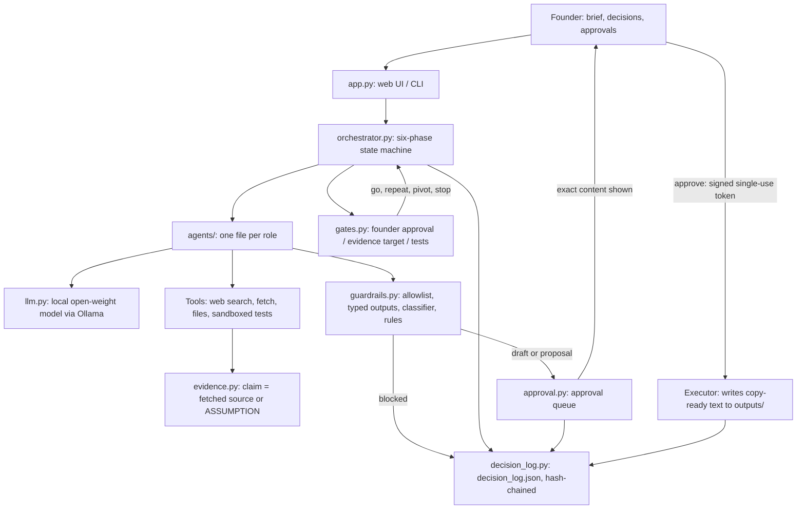
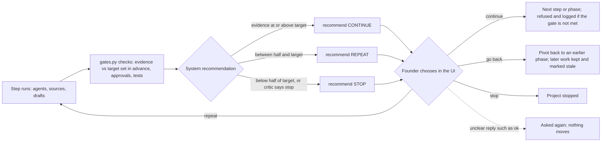

# Foundry Architecture

## Overview

Foundry is a team of AI agents run by a state machine. It takes a founder brief (starting idea, skills, budget, available time, target market, values) through six phases toward a validated, sellable digital product. Agents never act on the outside world: they produce drafts and proposals. Every step ends with a gate, every claim is sourced or labelled `ASSUMPTION`, every agent action is logged, and anything that would be published, sent, spent or signed waits for the founder to approve the exact content. Status labels in this file: **Working**, **STUBBED** (designed, not built), **MOCKED** (simulated and labelled).



## Phases

Each phase lists its agents, tools, method and output. Output files go to `outputs/` as `phase<N>_step<M>_<name>` and `phase<N>_gate_<name>`. Discover, Validate, Commercial setup, Launch drafting and the recorded-data Operate review are **Working**; Build and live operating integrations are **STUBBED**. See Built vs. stubbed.

### Phase 1: Discover

- **Core step:** find opportunities.
- **Agents:** `agents/researcher.py`, `agents/critic.py`.
- **Tools:** web search, page fetch, evidence store.
- **Sources:** founder-supplied URLs first, then up to 12 search results tried, one page per website before a second from the same site, keeping up to 5 readable pages. Pages that refuse automated readers or hold almost no text (cookie walls, error pages) are skipped and the skip is noted in the output. Foundry identifies itself honestly and does not get around a site's block.
- **Method:** read the founder brief. Foundry only works on digital products: an excluded product type (physical goods; financial, investment or crypto; health or legal advice) is rejected immediately, before any search or research, with a logged stop. Software for businesses that handle physical goods counts as digital. The researcher sharpens the idea and proposes two or three alternatives that fit the founder's skills, budget and time. Each option is scored on the same criteria (problem severity, reachable market, fit with the founder, cheapness of a first test), with every market claim tied to a fetched source or labelled `ASSUMPTION`. The critic then gives the strongest case, the top risks, kill criteria and the cheapest test that could disprove the idea; its output schema rejects an empty risk list. The researcher drafts a Mom Test interview script (questions about past behaviour, no pitching). Interviews are done by the founder; simulated interviews are labelled `MOCKED` and never count as evidence.
- **Output:** `phase1_step1_opportunities.md`, `phase1_step2_interview_script.md`, `phase1_gate_decision.md`.
- **Output validation:** option titles must be distinct and the recommendation must match a proposed option (case and whitespace differences are accepted). No highest-score fallback can silently substitute an idea. Interview questions reject common English hypothetical, future-plan and product-pitch patterns; polite requests about real past events remain valid. These are pattern checks, not a guarantee of interview quality. Validation failures trigger the existing structured-output repair retries; exhausted retries fail the step before its report is exported or its gate opens. The founder reviews the script in every case.

### Phase 2: Validate

- **Core step:** design the business.
- **Agents:** `agents/strategist.py`.
- **Tools:** evidence store, file tools.
- **Method:** at the end of Discover, before Validate starts, the founder fixes a demand target (for example 50 waitlist sign-ups from the target market); it is written to the log and cannot be changed afterwards. The strategist fills a Lean Canvas from the sources fetched in Discover and the quotes Discover already verified: each box is a claim, sourced only if its quote is found in a fetched page, otherwise `ASSUMPTION`. It names the riskiest assumption and writes a plan for a landing-page demand test. The landing page is rendered by code from typed fields, so it has placeholder slots (`[Real customer quote - collect after launch]`, `[YOUR-FORM-URL]`) and no testimonials, counters, prices or countdowns. The page (`deploy`) and an invite post (`post`) pass the guardrails and wait in the approval queue; the founder publishes them. The founder then records real results and confirms they are real people; simulated or test entries never count. Commercial setup opens only when this gate passes.
- **Output:** `phase2_step1_lean_canvas.md`, `phase2_step2_landing_page.html`, `phase2_gate_decision.md`.

### Phase 3: Build

**Status: `STUBBED`** (designed, not built in the prototype).

- **Core step:** build the product: a tested minimum version with user docs.
- **Agents:** `agents/builder.py` (plans and writes the product), with the critic reviewing the plan.
- **Tools:** file tools limited to the project's own workspace; a sandboxed test runner (separate container, no network, CPU and memory limits, read-only root, time limit); the evidence store.
- **Method:**
  1. *MVP plan.* From the Validate result and the canvas, the builder proposes the smallest product that tests the riskiest assumption: its format (template pack, short course, small web tool), what is in and out, and the user docs. The critic lists what the plan leaves untested. The founder approves the plan before anything is built.
  2. *Build.* The builder writes the product files and the tests that define "works" for this product: for software, unit tests; for a course or template pack, a checklist test (every promised module exists, links resolve, no placeholder text left). Example or sample content is labelled `MOCKED` until the founder replaces it.
  3. *Test.* The sandbox runs the tests and returns a report with each test's result. Agent text may not say the product works unless the runner's report says so.
  4. *User docs.* A short guide for buyers: what the product does and does not do, how to start, how to get help.
- **Gate:** tests pass, plus the founder's review. A failed test recommends REPEAT with the failing tests listed; a plan the founder rejects goes back to step 1. If the product cannot be built within the founder's budget and time, the system recommends going back to Validate or stopping. Deploying anything is a `deploy` action for approval.
- **Output:** `phase3_step1_mvp_plan.md`, `phase3_step2_test_report.md`, `phase3_gate_decision.md`.

### Phase 4: Commercial setup

- **Core step:** set the price and policies.
- **Agents:** `agents/pricing.py`.
- **Tools:** web search and page fetch (what similar products charge), evidence store, approval queue.
- **Method (Working):** opens only after the Validate evidence gate passes. The agent offers two or three price options with reasoning and names the one it recommends. Comparable prices are claims: sourced only if the quote is on a page fetched in the run, otherwise `ASSUMPTION`; willingness to pay is always an `ASSUMPTION` with a cheap test proposed. It drafts the terms, privacy and refund policies with placeholders such as [BUSINESS NAME], each marked as not legal advice. Each policy is queued as a `sign` action; approval exports the exact text as a copy-ready file. No payments of any kind: the founder sells through their own provider.
- **Gate:** all three policies approved by the founder; a rejected or blocked policy means REPEAT (new drafts). Launch cannot start until this gate passes.
- **Output:** `phase4_step1_pricing.md`, `phase4_step2_policies.md`, `phase4_gate_decision.md`.

### Phase 5: Launch

- **Core steps:** open the store; deliver automatically.
- **Agents:** `agents/launcher.py`; `delivery.py`.
- **Tools:** approval queue, file tools.
- **Method:** draft the store page and launch posts. Each draft enters the approval queue; the founder approves or rejects the exact text. Approved items are written to `outputs/` as copy-ready text for the founder to post; no posting connector exists. Copy may not promise income or invent urgency. Automatic delivery to buyers is **MOCKED**: a simulated order triggers a simulated delivery record, labelled as such (see Sale to cash).
- **Output:** `phase5_step1_store_page.md`, `phase5_step2_launch_posts.md`, `payment_test_log.md` (mocked delivery run), `phase5_gate_decision.md`.

### Phase 6: Operate and learn

**Status: `Working` for an internal learning review; live analytics and support connectors are `STUBBED`.**

- **Core step:** none in the problem statement; this phase closes the loop.
- **Agents:** `agents/operator.py`.
- **Tools:** read-only snapshots of this project's recorded demand, frozen target, evidence counts and draft approval/export counts. No store, payment account or analytics service is connected.
- **Method (Working):** after the founder explicitly continues the Launch gate, the operator reviews those recorded facts and their limits, recommends repeat, pivot or stop, and proposes bounded $0 experiments with a sample size, success threshold and duration. The metrics table is rendered by code, not invented by the model. Founder-recorded demand is not independently verified; exported drafts are not published posts or sales, and delivery is `MOCKED`. Missing usage, revenue and retention remain missing. Internal-output guardrails check the memo before persistence.
- **Gate:** continue acknowledges the memo only; repeat permits a fresh review; go back reopens the Launch review; stop halts the project. Every choice is logged with `approved_by: "founder"`. Because Build is still stubbed, this review does not advance the recorded Build phase or mark the venture completed.
- **STUBBED:** customer support replies, imported operating metrics and live telemetry.
- **Output:** `phase6_step1_pivot_memo.md`, `phase6_gate_decision.md`.

## Gates

Every step ends with a gate. After each step the system shows a summary, its recommendation and the choices, then waits for the founder.



The recommendation is computed by code from the numbers; the founder's choice is the only thing that moves the project, and every choice is logged with `approved_by: "founder"`.

| Gate type | What it checks |
|---|---|
| Founder approval | The founder has reviewed the step's output and chosen an outcome |
| Evidence target | Real demand recorded by the founder (sign-ups, interviews, pre-orders) reaches the target fixed before the phase started; at least one sourced fact exists. Fetched sources alone never meet a demand target |
| Tests pass | The sandboxed test run passed |

| Phase | Gate |
|---|---|
| Discover | Founder approves the sharpened idea |
| Validate | Evidence target reached, plus founder approval. Below target, continue is refused and the refusal is logged |
| Build | Tests pass, plus founder review |
| Commercial setup | All three policy drafts (terms, privacy, refund) approved by the founder, plus the founder's choice; otherwise REPEAT is recommended and continue is refused |
| Launch | No draft left unreviewed, at least one approved, plus founder approval |
| Operate and learn | Founder chooses the outcome from the memo |

**Outcomes:** go (advance), repeat, pivot back to an earlier phase, or stop. All four are logged with `approved_by: "founder"`.

**When the system recommends STOP.** `gates.py` returns a recommendation with every check. If the Validate evidence is below half of the pre-set target (example: target 100 sign-ups, got 12), the recommendation is **stop**, stated plainly with the numbers. Between half and the full target it is **repeat**. The system does not advance a project whose evidence gate has failed; the founder can repeat, pivot back or stop. Excluded product types are rejected immediately in Discover with a logged stop; no founder decision is needed for that. Downstream work is kept and marked stale on a pivot, never deleted.

## Sale to cash

**Not built. No payment code exists in this repository, not even sandbox.** This section is the design for a later version; in the prototype only delivery is simulated, and it is labelled **MOCKED**.

```
order placed ──> payment confirmed (by the founder's own provider) ──> delivery
                          │                                              │
                          └─ refund ──> access revoked                   └─ idempotency key = order id
                          
reconciliation: orders == payments - fees == payouts, mismatches listed for the founder
```

- **Payment triggers delivery.** The founder's own payment provider (outside Foundry) confirms a payment; that event carries an order id. Delivery grants access to the digital product for that order id.
- **Refund revokes access.** A refund event for an order id revokes that order's access.
- **Idempotency prevents double delivery.** Delivery is keyed by order id; a repeated event for the same order does nothing.
- **Reconciliation.** A periodic job matches orders, payments, fees and payouts and lists mismatches for the founder. Foundry reads these records; it never holds, moves or refunds money.
- **Prototype:** `delivery.py` accepts a simulated order, writes a `MOCKED` delivery record, and proves the idempotency and revoke rules in tests. The run log goes to `outputs/payment_test_log.md` and states that no payment took place.

## Data flow

1. The founder submits a brief. A brief containing a password, key or card number is refused and not stored. Otherwise the orchestrator creates a project and logs it.
2. Before any agent runs, guardrails read the brief as a founder request: keyword backstop, then the model classifier (two differently framed checks at temperature 0 with a fixed seed to reduce variation, not guarantee identical answers; any failure or doubt blocks). A refused request is logged and shown to the founder with the reason.
3. An agent runs a step: it calls the local model and allowlisted tools. Fetched pages become evidence records (URL, quote, date). A claim without a fetched source that contains its quote is stored as `ASSUMPTION`. Quote normalization ignores numeric citations but preserves bracketed words, including negations. Discover then uses two model checks to review whether each matched quote supports its claim: unsupported, uncertain or unavailable reviews downgrade the claim with a logged reason. This review is fallible, not independent fact-checking; the other phases and direct ledger APIs remain provenance-only. The agent returns a typed result.
4. Discover research, critic reviews, interview scripts and the Operate learning memo pass two dedicated internal-output model checks before use or export. These distinguish analysis and `do_not_ask` counterexamples from outcome promises or fabricated proof; uncertainty, model failure or an output over 20,000 characters blocks the step without silently truncating it. Only accepted output is written to `outputs/`; actions and blocks are recorded in `decision_log.json` with `agent`, `action`, `sources`, `model`, `cost`, `approved_by` and a hash chain (`prev_hash`, `entry_hash`).
5. The gate is evaluated and a recommendation is shown. The founder decides; the decision is logged.
6. Outbound items (post, email, listing, deploy, support reply, sign) pass the guardrails as agent output (keyword backstop and model classifier) and then enter the approval queue; a blocked draft is logged and never queued. Approval creates a signed, single-use token bound to the content hash; any edit cancels it. The executor verifies the token and writes copy-ready text to `outputs/`. `spend` has no executor.
7. `scripts/verify_decision_log.py` checks the required keys and the hash chain.

Storage: SQLite (`data/`) for projects, evidence and the approval queue; `decision_log.json` and `outputs/` as plain text.

The project's **Evidence & activity** page reads the project's claims, demand target and results, approval statuses and decision timeline from those existing stores. Its downloadable Markdown report is an internal research snapshot, not an approved outbound draft. Both views filter records by the exact project id; neither runs a model, appends a decision, writes pipeline outputs, issues approval tokens or executes an action. Signing secrets and approval tokens are not included. The interface keeps navigation available on narrow screens, provides a skip-to-content link and respects reduced-motion preferences.

The `/demo` page renders only an allowlist of committed Markdown artifacts from the run index. It does not initialize a workflow, call a model or change data. It preserves historical mistakes, distinguishes the unpublished-page gate demonstration from a real demand experiment, and excludes approval exports and tokens.

## Built vs. stubbed

| Part | Status |
|---|---|
| State machine, gates, STOP recommendation (`orchestrator.py`, `gates.py`) | Working |
| Founder brief intake and excluded-product screening (`agents/intake.py`) | Working |
| Web search through SearXNG and page fetch (`tools.py`) | Working |
| Evidence store (`evidence.py`) | Working; quote provenance plus a separate model claim-support review in Discover. Unsupported or uncertain Discover interpretations stay ASSUMPTION; other phases/direct APIs are provenance-only |
| Project Evidence & activity workspace and internal report download (`app.py`) | Working; read-only and project-scoped, no model call or approval action |
| Phase 1 Discover agents and step runner (`agents/researcher.py`, `agents/critic.py`, `workflow.py`) | Working |
| Step gates and approval screen in the browser (`app.py`) | Working |
| Phase 2 Validate: Lean Canvas, demand test, landing page, evidence gate (`agents/strategist.py`, `workflow.py`) | Working |
| Phase 4 Commercial setup: price options, policy drafts as `sign` actions, gate (`agents/pricing.py`, `workflow.py`) | Working; opens after Validate passes |
| Phase 5 Launch drafts into the approval queue (`agents/launcher.py`) | Working; opens after Commercial setup passes |
| Delivery (`delivery.py`) | MOCKED |
| Decision log (`decision_log.py`) | Working |
| Approval queue and tokens (`approval.py`) | Working |
| Guardrails: secrets detector, keyword backstop, tool allowlist (`guardrails.py`) | Working; keyword rules are English only |
| Guardrails: model classifier, two checks, fails closed (`guardrails.py`, `llm.py`) | Working on founder briefs, internal Discover outputs, learning memos and outbound drafts; a separate Discover claim-support surface checks interpretations, but none guarantees factual accuracy. Historical founder/outbound measurements are in `evals/results.md`; new surfaces have separate regression tests |
| Model adapter (`llm.py`) | Working |
| Phase 6 Operate recorded-data review (`agents/operator.py`) | Working; internal memo and founder gate, no live metrics, support connector or automatic experiments |
| Phase 3 Build | STUBBED |
| Sandboxed test runner, CLI | STUBBED |
| Posting connectors | STUBBED by design (copy-ready text only) |
| Payments, sale to cash | Not built; no payment code |

## Roadmap

Done in the prototype: brief intake with immediate rejection of non-digital products; Discover with fetched sources and step gates in the browser; Validate with a Lean Canvas, landing page, a demand target fixed in advance and STOP on weak demand; Commercial setup with price options and policy drafts approved as `sign` actions; the approval screen with Launch drafts and `MOCKED` delivery; guardrails with a fail-closed model classifier and public evals.

Next:

1. Speed: shorter agent outputs and parallel checks, so a full run fits in about three minutes on a laptop.
2. Guardrails: a stronger classifier model, dedicated checks on the remaining internal phases, wider repeated model evals, and claim-support reviews beyond Discover.
3. Build agent and live operating integrations.
4. After the hackathon: community playbooks per product type, more search sources, and a hosted option for founders who cannot run a model.
